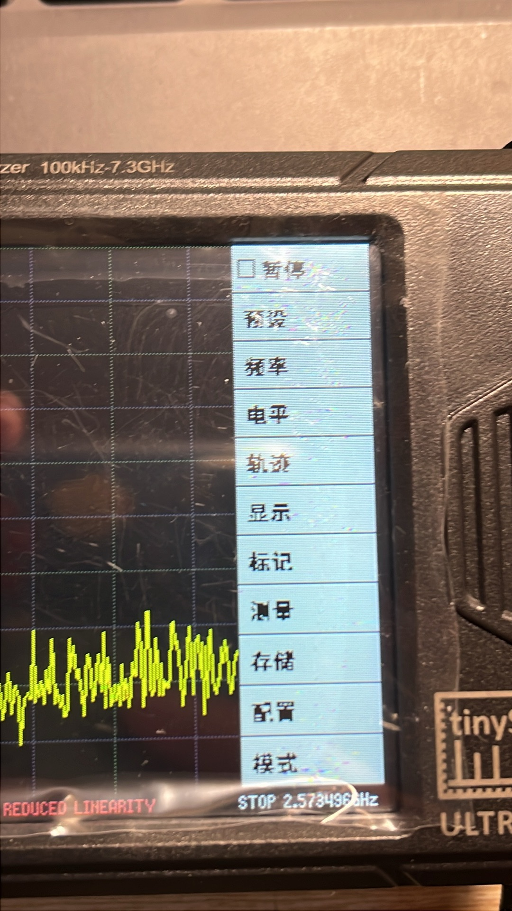
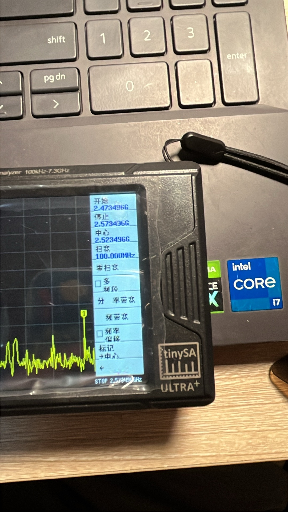

# tinySA 中文固件

本项目基于原版 tinySA 固件进行中文界面适配，旨在为中文用户提供更易理解的菜单、操作提示和使用体验。

## 📷 固件实机截图

以下为 tinySA Ultra 中文固件的实际运行界面。

| 中文菜单界面 | 测量界面 |
|:---:|:---:|
|  |  |

## 版本说明

| 版本 | 说明 |
|---|---|
| V9 | 中文固件第九版，具体修改内容请查看对应版本说明 |
| V10 | 中文固件第十版，持续完善中文界面与相关功能 |

请在 GitHub 的 Tags 或 Releases 页面选择对应版本。

## 项目内容

- 中文界面相关代码
- 中文字体支持
- 原版 tinySA 固件源码及相关构建文件
- 各版本使用说明

## 编译说明

本项目沿用原版 tinySA 的构建环境和编译流程。编译前请先阅读原项目文档，并根据对应硬件型号配置开发环境。

## 使用说明

1. 下载对应版本的完整源码或发布文件。
2. 阅读该版本的使用说明。
3. 确认设备型号及固件兼容性。
4. 刷写前备份原有固件，并确认文件来源及刷写步骤正确。

刷写固件存在设备无法正常启动的风险，请谨慎操作。

## 版权与许可

本项目基于原版 tinySA 固件进行修改。原项目的版权声明、许可证及第三方组件许可应以各自源文件和原项目发布的许可文件为准。

中文界面相关修改不代表原版项目作者对本项目提供背书或支持。

## 免责声明

本项目按现状提供，仅用于学习、研究和设备功能适配。使用者应自行确认固件与设备的兼容性，并承担刷写及使用风险。
